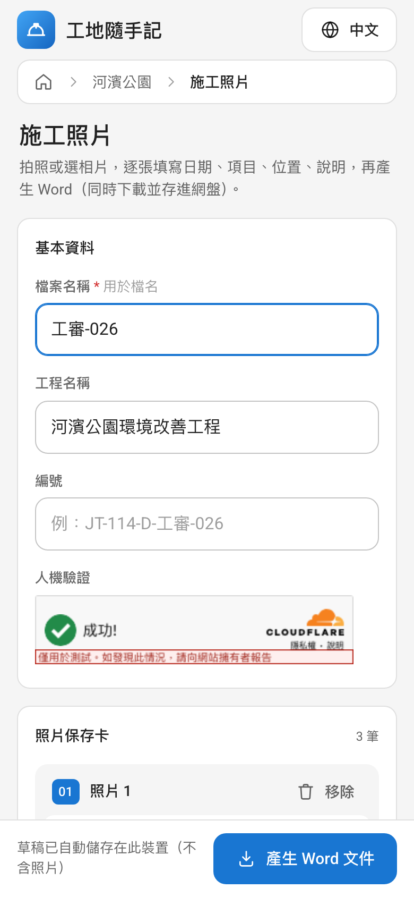
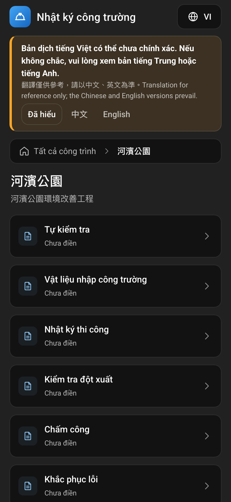
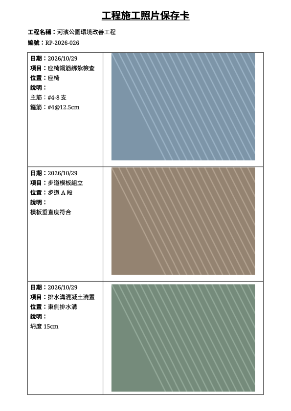
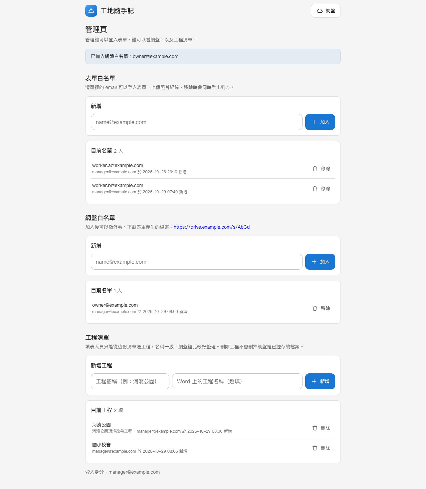

# 工地隨手記 Site Log

外部人員用手機拍工地照片、填寫紀錄，伺服器產生 Word＋PDF，自動存進自架網盤。以一台 $12／月的 AWS Lightsail 主機，配 Cloudflare Zero Trust 做登入與白名單，取代原本「一台 Windows 電腦要一直開著」的系統。

> A self-hosted site-photo log for construction crews: field staff fill a mobile form, the server renders a Word document (plus PDF) and files it into a self-hosted drive. Runs on a single small VPS behind Cloudflare Tunnel and Access; no inbound ports are open.

<p>
  
  
  
</p>

## 功能

**填表人員（手機）**
- 工程 → 7 類表單 → 每筆一張照片＋日期、項目、位置、說明；草稿自動存在手機上，照片在手機先縮到 1600px 再上傳
- 送出後下載 PDF，同時把 Word 和 PDF 存進網盤 `form-output/年/月/`
- 介面可切換 **中文／English／Tiếng Việt／ไทย**（給移工用；越南文、泰文頁面會提示「翻譯僅供參考」，可縮成一行）
- 照片一律在伺服器重新編碼：去掉 EXIF／GPS、擋掉假圖片與解壓縮炸彈

**管理者（`/admin`，不用進 Cloudflare 後台）**
- 表單白名單、網盤白名單：新增／移除 email；移除時呼叫 Cloudflare API 立刻撤銷對方登入
- 工程清單：填表人員只能從這份清單選，網盤裡的檔名和分類才一致
- 頁面沒有 JavaScript；POST 檢查同源（擋 CSRF）



**維運**
- 每天把網盤資料庫備份到 Cloudflare R2（保留 7 份），另有 Lightsail 每日快照
- 每 5 分鐘健康檢查：容器狀態、外部連線、每小時實際寫一次檔案到網盤／R2、硬碟、備份新鮮度、程式錯誤 log；有異常傳 Telegram，恢復時再通知一次
- GitHub Actions 每次 push 跑 120 個測試

## 架構

```
手機 ─HTTPS─▶ Cloudflare（Access：email 驗證碼白名單、Turnstile）
                  │ Cloudflare Tunnel（主機主動連出去，主機不開 80/443）
                  ▼
  VPS     ┌ cloudflared ─▶ caddy ─┬─▶ form-app:8000 ──▶ gotenberg:3000（Word 轉 PDF）
 (Docker) │                       │        │ WebDAV（compose 內網）
          │                       └─▶ cloudreve:5212 ◀┘（網盤）
          └ cron：backup.sh、healthcheck.sh ──▶ Telegram
                                     │
                                     ▼
              Cloudflare R2：網盤檔案（私有 bucket）、每日備份（另一個 bucket、另一把金鑰）
```

| 元件 | 用途 |
|---|---|
| **form-app**（FastAPI） | 表單頁、`POST /submit`、`/admin`。docxtpl 在記憶體產生 Word，不寫暫存檔 |
| **Gotenberg**（LibreOffice） | Word 轉 PDF。只在內網、關掉「從網址下載」和 webhook；轉檔失敗就改給 Word，不擋住送出 |
| **Cloudreve** | 自架網盤。檔案存在私有 R2 bucket，bucket 金鑰只放在 Cloudreve |
| **Caddy** | 反向代理；擋掉外部的 `/dav`，WebDAV 只給 form-app 走內網 |
| **cloudflared** | Cloudflare Tunnel，主機防火牆只開 SSH（限定來源 IP） |

### 資安設計

| 層 | 做法 |
|---|---|
| 登入 | Cloudflare Access email 驗證碼白名單；form-app 再驗 `Cf-Access-Jwt-Assertion`（RS256、AUD、發行者、到期，擋 HS256 偽造），避免繞過 Cloudflare 直接打主機 |
| 機器人 | Turnstile，伺服器端 siteverify，檢查 action 與 hostname |
| 頻率與大小 | 每個 IP 每分鐘 5 次；Caddy 和 form-app 都限 60MB；最多 30 張、每張 8MB |
| 儲存 | form-app 不碰 bucket，一律經 Cloudreve WebDAV；備份金鑰與網盤金鑰分開，各自只能存取自己的 bucket |
| 瀏覽器 | CSP（script 只允許每次請求不同的 nonce）、禁止 iframe 嵌入、`no-store` |
| 容器 | 非 root、根目錄唯讀、`cap_drop: ALL`、`no-new-privileges`、記憶體上限；image 一律釘版本，GitHub Action 釘 commit SHA |
| 機密 | `.env`、備份與通知設定都只在主機上（權限 600），不進 repo、不給不需要的容器 |

## 技術

Python 3.12 · FastAPI · docxtpl · Pillow · httpx · PyJWT · Jinja2 · 原生 JavaScript（無框架、無建置步驟）· Docker Compose · Caddy · Cloudreve 4 · Gotenberg · Cloudflare Tunnel／Access／Turnstile／R2 · AWS Lightsail · Bash · GitHub Actions · pytest＋respx

## 專案結構

```
docker-compose.yml        本機與正式環境共用（caddy、cloudreve、form-app、gotenberg）
docker-compose.prod.yml   正式環境疊加：加 cloudflared、caddy 不開 port
Caddyfile
form-app/
  app/main.py             路由：表單頁、/submit、/projects、/admin
  app/docgen.py           docxtpl 產生 Word      app/pdf.py        呼叫 Gotenberg
  app/images.py           照片驗證與重新編碼     app/storage.py    WebDAV 上傳（重試、同名加序號）
  app/security.py         Turnstile、Access JWT  app/whitelist.py  Cloudflare 清單與撤銷登入
  app/projects.py         工程清單（JSON 檔）    app/messages.py   四種語言的錯誤訊息
  app/templates/          index.html（表單）、admin.html（管理頁）
  tests/                  120 個測試
scripts/                  bootstrap_server.sh、deploy.sh、backup.sh、healthcheck.sh、notify.sh …
```

## 本機啟動

需要 Docker Desktop。

```bash
cp .env.example .env
docker compose up -d --build
```

- 網盤：http://drive.localhost（第一個註冊的帳號是管理員）
- 表單：http://form.localhost（本機不驗 Cloudflare Access；Turnstile 用官方測試金鑰）

### Cloudreve 初始設定（只做一次）

1. 管理後台 → 設定：關閉「允許新使用者註冊」。
2. 新增群組 `form-app`：權限只開 WebDAV，並選好儲存策略（沒選的話 MKCOL 成功、PUT 卻回 404）。
3. 新增 form-app 專用使用者，建立資料夾 `form-output`，再建一個根目錄是 `/form-output` 的 WebDAV 帳號，把帳密填進 `.env` 的 `WEBDAV_USER`、`WEBDAV_PASSWORD`。
4. `docker compose up -d form-app`，再驗證：`docker compose exec -T form-app python - < scripts/check_webdav.py`

### 測試

```bash
cd form-app
docker compose build form-app
docker run --rm --user 0 -e PIP_ROOT_USER_ACTION=ignore -v "$PWD":/srv -w /srv sitelog-form-app:local \
  sh -c "pip install -q -r requirements-dev.txt && python -m pytest -q -p no:cacheprovider"
```

涵蓋：Access JWT（錯的金鑰／AUD／發行者／過期／HS256 偽造）、Turnstile、速率限制、照片驗證（EXIF/GPS、解壓縮炸彈、假圖片）、欄位驗證與四種語言錯誤訊息、Word 內容、PDF（成功、轉檔失敗改給 Word、存檔失敗）、WebDAV 重試、白名單管理與撤銷、工程清單、CSRF、CSP nonce。

## 部署到 Lightsail

### 手動步驟 1：主機

Lightsail（或任何 VPS）：Ubuntu 24.04、2GB RAM。建立靜態 IP；防火牆**只開 SSH 並限定自己的 IP**，不開 80/443；開啟每日自動快照。

### 手動步驟 2：Cloudflare

1. **Tunnel**：建立通道，把 `form.example.com`、`drive.example.com` 都指到 `http://caddy:80`，token 填 `.env` 的 `TUNNEL_TOKEN`。
2. **Access**：表單和網盤各一個自我託管應用程式，原則用 email 清單（見下方「網盤白名單」）；AUD 和團隊網域填 `ACCESS_AUD`、`ACCESS_TEAM_DOMAIN`。健康檢查的兩個路徑另建一個 Bypass 應用程式。
3. **Turnstile**：主機名稱 `form.example.com`，金鑰填 `TURNSTILE_SITE_KEY`、`TURNSTILE_SECRET`。
4. **R2**：兩個私有 bucket（網盤、備份），各建一把只限該 bucket 的「物件讀寫」權杖。

### 手動步驟 3：安裝

```bash
git clone <repo> /srv/sitelog && cd /srv/sitelog
sudo bash scripts/bootstrap_server.sh      # Docker、自動安全更新、SSH 只允許金鑰
cp .env.example .env && chmod 600 .env && nano .env   # COMPOSE_FILE 疊上 prod、網域、各種金鑰
scripts/deploy.sh
```

### 手動步驟 4：備份與通知

```bash
sudo nano /etc/sitelog/backup.env     # R2 備份 bucket 的端點與金鑰（root、600）
sudo nano /etc/sitelog/notify.env     # TG_BOT_TOKEN、TG_CHAT_ID
sudo install -m 644 scripts/sitelog-backup.cron /etc/cron.d/sitelog-backup
sudo install -m 644 scripts/sitelog-health.cron /etc/cron.d/sitelog-health
```

更新：`cd /srv/sitelog && scripts/deploy.sh`（`git pull`、重建 form-app、重啟）。

## 網盤白名單

網盤網域也放在 Cloudflare Access 後面，和表單共用同一個團隊網域的登入（登入過其中一個，另一個不用再收驗證碼）：

- Access 原則：Include ＝ Zero Trust email 清單「網盤白名單」**或** 管理者 email。管理者直接寫在原則裡，不會被自己從清單刪掉。
- 白名單上的人**不需要網盤帳號**：用 email 驗證碼打開 `form-output` 的分享連結（`DRIVE_SHARE_URL`），只能看、下載。為此 Cloudreve 的 `Anonymous` 群組開啟「存取分享連結」，擋人的工作交給 Access。
- `.env` 的 `CF_DRIVE_LIST_ID` 填清單 ID，`/admin` 就會出現這一區；`CF_API_TOKEN` 只需要「帳戶 → Zero Trust → 編輯」。

## 授權

[MIT](LICENSE)。Roboto 字型依 SIL Open Font License 1.1（`form-app/app/static/fonts/LICENSE.txt`）。
